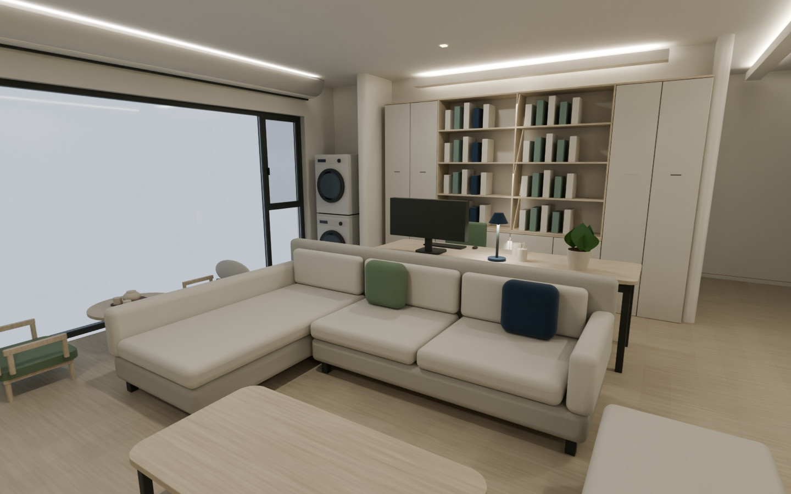
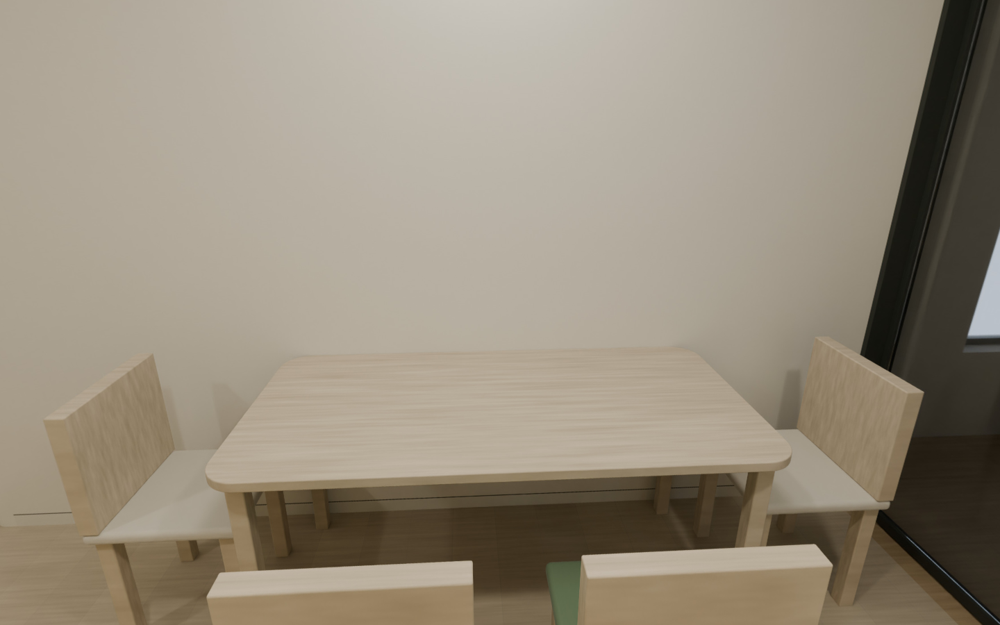
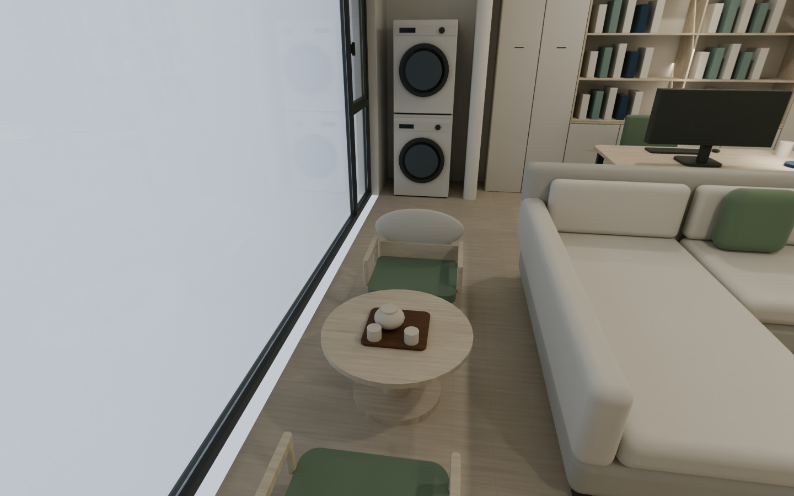
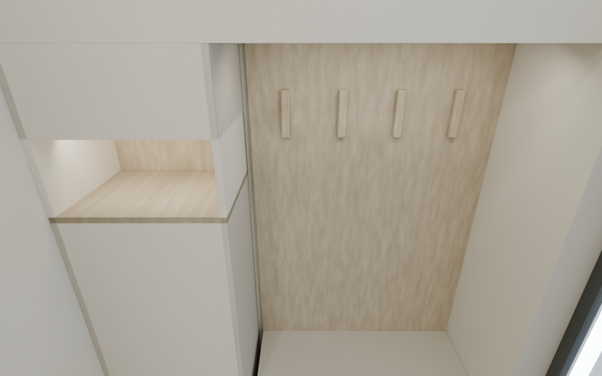

# v13 四区全景审查

审查日期：2026-10-31。审查范围：餐厅、门厅、客厅、阳台的 **2K 原生全景试图**及浏览器透视视窗。结论：四个观察点与当前布局一致，可以继续制作同版8K交付；本记录不宣称已目检尚在生成的8K成图，也不替代现场尺寸、产品与施工核验。

本次由独立于建模、渲染与浏览器制作任务的AI审查任务复核文件和图像；没有人工设计师或第三方工程师签审。审美与实用性意见分别列示，不设缺少固定历史基线的分数、相似度百分比或“整改率”。预算按业主最新要求不参与判断。

## 依据及视图条件

- 设计基准：业主已确认的现代日式、干净暖白与浅木、局部奶黄色，绿色和深蓝点缀；哑光墙面、直线骨架及桌角/墙角/柜端柔弧；门厅、电视墙、灯光与窗帘参考业主PDF，不把参考案例的尺寸或品牌直接当成本户条件。
- 来源：`01_brief/project-brief.md`、`assumptions.md`、`decisions.md`与`current-design-constraints.json`；几何`02_geometry/geometry-master-v13.json`、风格`05_style/modern-japanese-v09.json`、`logs/v13-source-ledger.json`及`model-v13-build.json`。
- v13几何SHA256：`50821200f2667b368324364e860df49b09962f80910bf035743246fd7613655f`。主模型配置记录SHA256：`ce3d1f7cf782ad4d718a40751b5d9812559d6dbd3609fa5cbdc7109ee6b383f3`。审查时活动入口仍指向v12，本文明确审查本轮v13候选及其试图，不混称已切换活动入口。
- 逐张目检`07_renders/vr-tour-v01/{living,dining,balcony,entry}-draft.png`：2048×1024，2:1，Cycles原生360°×180°单眼等距柱状全景，没有AI重绘。另逐张目检`logs/vr-tour-v01-draft-{living,dining,balcony,entry}-perspective.png`，四个默认视窗均为60°视场。
- `tools/render_panorama_v13.py`表明：试图32采样，最终8192×4096、192采样；均重开同一份保存的v13模型，采用相同机位、日间场景、帘片全收起状态。8K提高角分辨率与采样，不自动改善布局、贴图建模或现场准确性。最终仍需检查文件完整性、四幅图与最终浏览器画面。

## 审美复核

四区第一眼气质均为浅木、暖白、安静克制；餐厅和门厅因位置较内侧显得更温暖，阳台日光区域更亮。没有出现每个区域独立重绘导致的家具数量、材质或门墙关系跳变。

| 区域 | 图像中可见证据 | 判断及交付注意 |
|---|---|---|
| 客厅 | 贵妃沙发、两只绿/深蓝抱枕、空台面圆角茶几、脚凳及沙发后单屏办公桌可辨；大书柜、电视背景和悬空木柜在同一全景内闭合对应。 | 浅木与米灰形成主体，绿色/深蓝保持小面积，留白与已选方向一致。默认面向沙发，电视需要转身观看，是同一观察点的方向选择。2K放大后的织物与木纹偏软，不能据此判断最终材质细度。 |
| 餐厅 | 四椅靠墙桌、同面暖白墙、玻璃推拉门、对侧奶黄/奶油白通顶长柜及胡桃木浅格同时存在。 | 餐桌没有变成岛台或卡座。默认视窗近处椅背和桌面较大、墙面占比高，反映机位离桌较近；转向后能看完整客厅与门厅联系。适合空间环顾，不能把这一个默认画面当作全部餐厅构图。 |
| 阳台 | Ø700矮圆桌、一壶两杯、两把绿色坐垫低椅；贵妃榻、洗烘叠放、大窗和三盆高低绿植延续同版关系。 | 低茶席尺度与普通餐桌区分明确，浅木、绿色与客厅连贯。1600眼高向下看茶桌，椅背部分进入近景，符合站立观察；不是已增加坐姿节点。窗外为浅色占位环境，不是实景照片、实际视野或磨砂玻璃选型。 |
| 门厅 | 一字短墙柜整合上柜、换鞋坐位、挂钩和随手格；镜面可见通长柜与过道反射，原L形长边未回生。 | 木背板使挂衣位更有层次，暖白柜与奶黄通长柜相接协调。默认近看柜体，转身再看通向餐客厅的联系；镜中重复的门洞属于反射，不应误读成多设了一道入户门。 |

电视低柜、桌面和入口坐位的圆角可见；没有把整屋直线骨架改成连续曲墙。通顶长柜顶部未出现开放空档。实际材色、光泽、板缝和产品五金仍是模型意向。日间灯槽与局部照明有层次，但本轮没有夜景全景，不能据此认定夜间氛围、眩光、照度或梦幻帘隐私已经通过。

## 投影及空间比例

- 原生全景展开图中，窗框、柜顶、直墙与地板线在大视角下呈弯曲，是把球面方向摊到矩形产生的投影表现；不能把展开图上的弯线当成墙窗真的新增了弧形。项目原有R180反光槽和局部圆角是另有几何来源的设计内容。
- 浏览器透视视窗恢复了可理解的单一观察方向。餐厅近处椅背大、远处沙发小；客厅前侧家具大、书柜和远处餐区小，符合普通透视的近大远小，没有发现此前担心的反透视。
- `vr-tour-v01-draft-viewer-verification.json`记录透视球面投影、连续360°回绕、上下极点和四节点切换通过；目检未见明显物件断接或因视图切换而换成不同布局。2K试图的柔化、锯齿与模糊不能通过扩大视角“修复”，应由同版8K成图改善细节。
- 本交付可准确称“单眼360°全景漫游”：环顾、缩放、固定节点切换。没有双眼立体视差或六自由度自由行走；没有头显或实体手机实测记录。

## 实用性与机位复核

机位均采用平面坐标`x/z`，眼高均为离地1600毫米；未通过放到桌心或家具内部来扩大画面。以下净距按本轮家具及构件的平面包络计算，是**相机中心至障碍包络**，不是整个人的通行净宽或实测认证。

| 区域 | x / z / 眼高（mm） | 最近包络及距离 | 复核 |
|---|---:|---|---|
| 门厅 | 635 / 10100 / 1600 | 镜面619 | 位于一字柜前地面，未穿镜面或短隔墙。 |
| 餐厅 | 1100 / 8000 / 1600 | 通长柜700；餐椅约732 | 位于柜与餐椅之间的地面，未放在餐桌上。 |
| 客厅 | 1800 / 4500 / 1600 | 茶几约875 | 处于家具外侧通行地面；沿用三件最新位置。 |
| 阳台 | 2050 / 850 / 1600 | 低绿植约474；低椅530 | 位于茶席左侧地面，未穿茶桌、低椅、窗或贵妃榻。 |

三件最新绝对位置为沙发3100/1300、脚凳3200/4350、茶几2550/2650；23件家具没有减少。源账本记录组成件包络检查：家具之间、墙窗、推拉门开闭、窗帘开闭与预留扫动区均未发生静态交叠。这与图中所见相符，但不证明家具拉出、多人同时使用或所有设备维护动作充分。

以下既有待核项在本次全景中仍然存在，不为了出图而自动移动业主家具：

- **门厅**：模型横向1271、镜位1254；入户门实测宽度、开向和门扇包络未知。全景中的外侧开口仅为占位显示，不能判定入户门是玻璃门，也不能据此承诺开门换鞋互不干扰。
- **餐厅**：原四号餐椅包络末端距推拉门线约285；静态无碰撞不等于椅子后退和厨房出入可同时进行。默认近景应如实保留空间紧凑感。
- **办公区**：办公椅至书柜既有局部约408的使用余量仍待体验，不把视觉上能看见地板等同椅背后通道充足。
- **阳台**：茶桌至沙发最近模型间距330，不作为主通道；洗烘与帘片预留区的既有局部约10余量需待具体设备、窗把手与帘系统联合深化。窗外、窗洞与设备尺寸仍按现有资料暂拟。
- **其他区域**：主卫扩建仍为独立研究，私人房间边界未变；透过玻璃能见的未深化厨房保持占位状态，没有擅自加入厨房方案。

## 可交付性与后续检查

本轮四幅2K试图足以核对观察点、家具布局、方向和统一材色，可作为8K渲染的构图基准。未发现需要为了全景制作而重新布局或改变墙体的确定问题。继续保持同版模型，提高分辨率与采样即可；最终出图后仍应逐幅确认无渲染中断、无黑图、纹理清晰度和球面回绕正常，并在交付浏览器中再次验证四区切换。

本审查没有要求增加预算约束、重选家具、替换奶黄柜或虚构窗外景色。后续深化集中于实际门窗设备、收纳物品与使用动作；这些问题不由8K图像本身解决。

## 最终8K复核补记

四幅8192×4096最终原生全景均已完成。根助手目检四幅完整球面展开图及客厅透视、天顶/地面、接缝两侧；查看器制作任务另逐图目检四幅最终透视画面与完整桌面/触控模拟界面。未发现倒置、黑屏、缺顶缺底、接缝跳接或家具布局变化。JPEG封装仅改变编码，不作AI补画。

最终查看器16项检查通过，报告`logs/vr-tour-v01-verification.json`；四张8K解码/切换、离线/无外链、触控模拟、320像素和4096纹理上限降采样均通过。实体手机与头显仍未实测。最终文件核对见`logs/v13-panorama-visual-review.json`，原2K试图证据保留在项目日志中。

## 最终透视图证据

