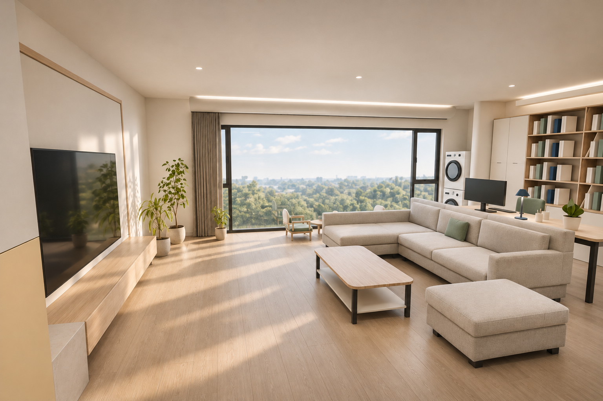
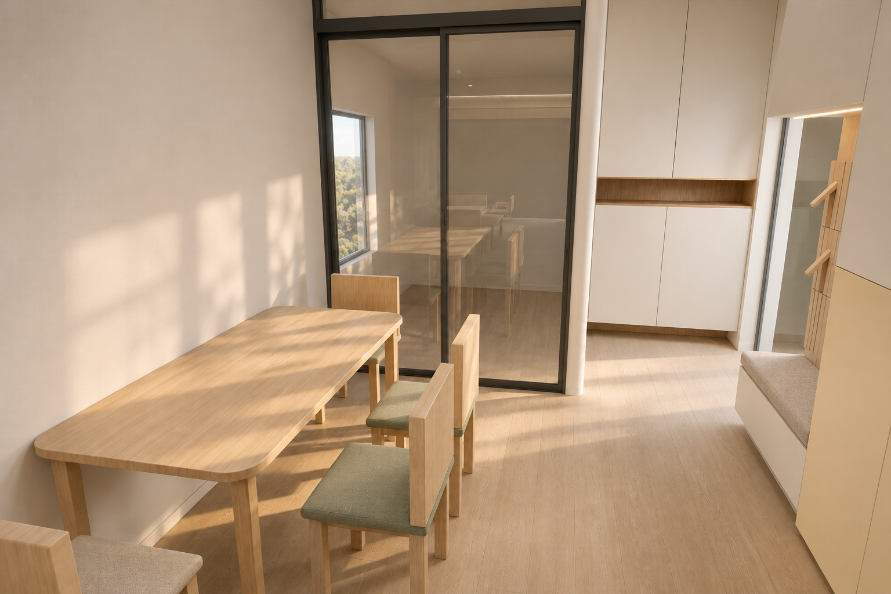
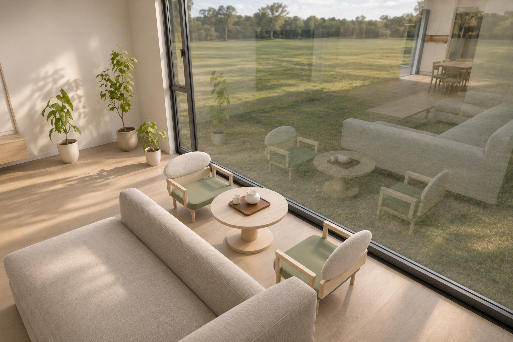
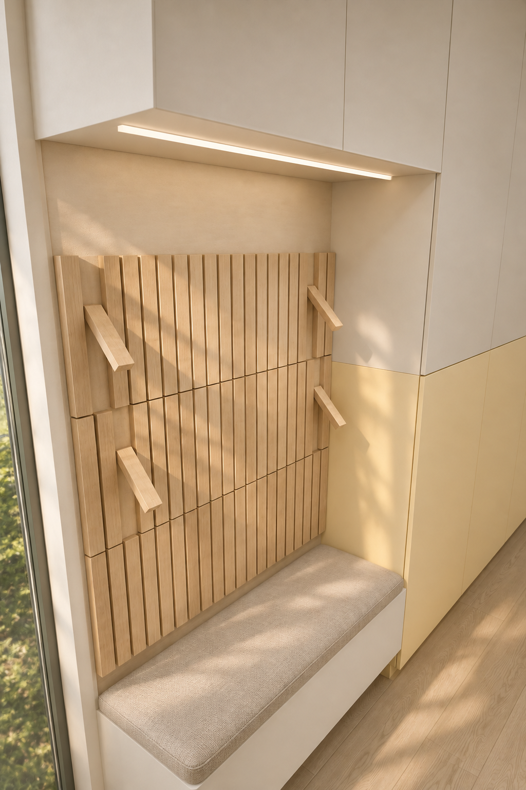

# 房屋设计项目 · HomeDesign

基于业主手绘尺寸、功能批注及持续交互调整的住宅装修设计档案。当前主模型、交互布局与摄影感表现统一为 **v18**：进门右侧通顶鞋柜，左侧换鞋凳与浅木钢琴键挂板，上柜连续到顶。保留最新沙发、脚凳、茶几位置及v14主卧主卫概念。现代日式、暖白浅木、奶黄柜、绿与深蓝点缀；后续不考虑预算。尺寸与施工条件仍待核。

## 查看当前成果

- **主卧主卫调整**：[本轮说明与图集](09_delivery/v14-master-suite/调整说明.md) · [平面图](09_delivery/v14-master-suite/主卧主卫调整平面.png) · [主卫实体效果](07_renders/v14-master-suite/master-bath.png) · [剖切观察](07_renders/v14-master-suite/master-suite-cutaway.png)。扩展主卫内依次洗手台—马桶—淋浴，无浴缸，另加入2米床及左侧衣柜。
- **本轮门厅与四区效果**：[五张效果图](09_delivery/v18-entry/index.html) · [调整说明](09_delivery/v18门厅调整说明.md)。右鞋柜1271×350×2750，左换鞋区1000×400、座450 mm，均为方案拟定尺寸；开键示意与五金需深化。
- **当前摄影感360°全景**：[打开v18全景](09_delivery/vr-tour-v04/打开360全景漫游.html) · [离线ZIP](09_delivery/v18-门厅与四区全景.zip) · [说明](09_delivery/vr-tour-v04/摄影感全景说明.md)。同版原生完整球面基准＋内置imagegen摄影感表现，原生1774×887，未放大冒充4K/8K。下载后用浏览器双击打开，GitHub文件页显示源文件。
- **保留的原生8K模型渲染**：[v15漫游](09_delivery/vr-tour-v02/打开360全景漫游.html) · [原生8K离线ZIP](09_delivery/四区写实360全景-v15.zip)。原完整球面模型渲染保留，与本轮摄影感预览分别标注。
- **历史全景**：[原v13漫游](09_delivery/vr-tour-v01/打开360全景漫游.html) · [原完整交付包](09_delivery/v13-餐厅门厅客厅阳台360全景漫游.zip)。旧模型、图片及源记录继续保留。
- **可移动家具模型**：[house-v18-preview.html](09_delivery/house-v18-preview.html)。28件可悬停看长宽高、按100mm移动；主卫门和淋浴隔断可开合。新增换鞋组合含上柜，标签总高2750、座高另列450；洁具移动仅供试排，修改位置后需重新渲染全景。
- **最新深化建议（尚未实施）**：[四区美观与实用性深化建议](04_reviews/四区美观与实用性深化建议-待选.md)。包括灯光、色彩、家具、收纳、门墙收口与两处椅后空间试排。
- [当前项目概要](01_brief/project-brief.md) · [用户决定](01_brief/decisions.md) · [假设与待核验](01_brief/assumptions.md) · [项目状态](logs/project-status.md)

| 客厅 | 餐厅 |
|---|---|
|  |  |
| 阳台 | 门厅 |
|  |  |

上述为v18同版模型的摄影感透视效果。全景另有四点原生1774×887、360×180单眼影像，近距离放大清晰度低于旧版8K；AI细节和窗景为示意，不替代几何。可拖动、缩放和切换四个固定观察点，不含自由行走或双眼立体。电脑Chrome离线和浏览器触控模拟通过，实体手机及头显未实测。

## Railway 在线入口

仓库根目录的 `Staticfile` 将 `09_delivery/` 设为静态网站目录，首页为 `09_delivery/index.html`，提供「写实 VR 全景」与「可移动家具模型」两个入口。Railway 服务使用 Railpack、Root Directory 保持 `/`，不需额外的构建或启动命令；推送到服务连接的分支后自动部署。若设置过 `RAILPACK_STATIC_FILE_ROOT`，请移除或改为 `09_delivery`，以免覆盖 `Staticfile`。

首页链接 `vr-tour-v04/打开360全景漫游.html`、`house-v18-preview.html`和`v18-entry/index.html`。旧全景留档；缺失页面返回404，不回退首页。`.dockerignore`仅纳入交付目录，并排除ZIP、草稿和未完成包。

自定义 `Caddyfile` 监听 Railway 提供的 `PORT`（本地缺省 8080），保留现有模型页面自身的内容安全策略，避免额外响应头阻止其内嵌运行时。Railway 生成公开域名时目标端口使用服务的 `PORT`（通常为 8080）。

## 当前可编辑主文件

| 文件 | 用途 |
|---|---|
| [home-main-v18.blend](06_blender/home-main-v18.blend) | 当前完整墙体、28件家具／洁具，右鞋柜与左钢琴键换鞋区、v14主卫、写实材质及照明 |
| [active-model.json](06_blender/active-model.json) | 当前模型入口、版本、路径与SHA256 |
| [geometry-master-v18.json](02_geometry/geometry-master-v18.json) | 当前毫米几何、家具组成件、来源和兼容位置基线 |
| [modern-japanese-v18.json](05_style/modern-japanese-v18.json) | 当前风格与门厅细化参数 |
| [blender-layout-v18.json](03_layout/blender-layout-v18.json) | 当前家具位置与实际MCP核验记录 |
| [v18-delivery-verification.json](logs/v18-delivery-verification.json) | 本轮交付与源文件核验 |
| [home-v14-photoreal-v15.blend](06_blender/home-v14-photoreal-v15.blend) | 同一布局的写实表现模型，纹理以相对路径引用08_assets目录 |
| [active-presentation.json](06_blender/active-presentation.json) | 当前写实模型、素材、全景及来源哈希 |
| [v15-photoreal-delivery-verification.json](logs/v15-photoreal-delivery-verification.json) | 历史原生8K全景、包络、接缝与查看器核验 |
| [home-v16-reference-anchor.blend](06_blender/home-v16-reference-anchor.blend) | 历史摄影感空间基准，v18继承其PBR外观与最新位置 |
| [presentation-layout-v16.json](02_geometry/presentation-layout-v16.json) | 历史最新位置快照，是本轮迁移来源 |
| [photographic-reference-v16.json](05_style/photographic-reference-v16.json) | 已选摄影感与光影目标；仍作风格参考 |
| [vr-tour-v04-verification.json](logs/vr-tour-v04-verification.json) | 当前四点全景16项浏览器核验 |

沙发、脚凳、茶几的平面x/z坐标为3100/1400、3200/4450、2550/2850 mm，本轮已写入主模型；旧状态重复恢复不叠加偏移。v14完整原文件、已存会话副本、v15／v16及旧全景留档。主卫墙按书柜收回200 mm的v17请求仍待门口安排，未擅自移动床或改变门洞；研究图见`09_delivery/v17-alignment-study/`。

## 目录

| 目录 | 内容 |
|---|---|
| `00_source/`、`00_sources/` | 手绘图、功能批注、交接资料、PDF参考与已提取参考页 |
| `01_brief/` | 需求、用户决定、假设与当前设计原则 |
| `02_geometry/` | 各阶段几何、当前主几何与来源关系 |
| `03_layout/` | 布局、交互保存状态及迁移输入 |
| `04_reviews/` | 审美与实用性审查、未选深化建议 |
| `05_style/` | 风格版本、柜体候选与用户选择 |
| `06_blender/` | 当前及历史可编辑Blender模型 |
| `07_renders/` | 实体渲染、AI概念表现、8K全景原图、提示词与来源清单 |
| `08_assets/` | 写实PBR纹理、植物及环境光素材、许可和源文件哈希 |
| `09_delivery/` | 各阶段离线页面、示意图、说明与交付压缩包 |
| `logs/` | 实际运行、源哈希、保存重开、交互与浏览器核验 |
| `tools/` | 本项目建模、迁移、渲染、导出及核验脚本 |

## 单位、版本与使用边界

- 项目几何记录使用毫米；Blender使用米，图面`(x,z,height)`映射为`(x,-z,height)/1000`。方位按业主说明为上南下北、左东右西，并非测绘方位。
- 100mm是家具操作步长，不能代表现场尺寸精度。外轮廓、门窗、净高、结构、排水、设备与施工节点的未核项见假设记录。
- 当前模型与历史版本分开保存。修改前读取活动入口及最新布局，避免用旧交互快照覆盖新家具或重复叠加历史偏移。
- 实体模型、AI概念图和历史独立研究分别标明来源；v14主卫已接入概念模型，仍须核实扩卫允许性与机电条件。AI图像细节没有自动回写正式几何。
- 后续设计不考虑预算。收纳物品清单、材料实样、具体家具灯具和设备仍需深化。

## 本地运行环境

项目已在Windows、本机Blender 4.5.15 LTS及mcp-for-blender 2.2.6环境中使用。脚本中保留了原本机工作路径；迁移电脑时请先调整项目根目录和运行时路径，再按各脚本输入与版本约束运行。Python依赖清单见`tools/requirements-design.txt`和`tools/requirements-mcp.txt`。

`tools/runtime/`、下载的软件安装包、Python缓存、机器凭据不纳入版本仓库；设计原始资料、历史模型、图片、全景、交付包和审查记录保留。软件与依赖需在新电脑上另行安装，不能把环境安装视为所有历史脚本可无条件执行。

`.gitattributes`禁用换行转换，以保留几何、风格和来源文件的原始字节，确保记录的SHA256在不同平台克隆后仍可核验。
