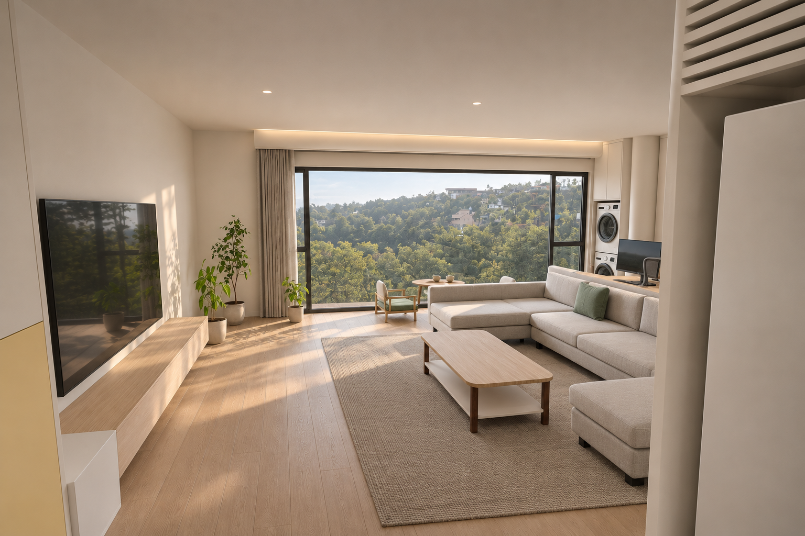
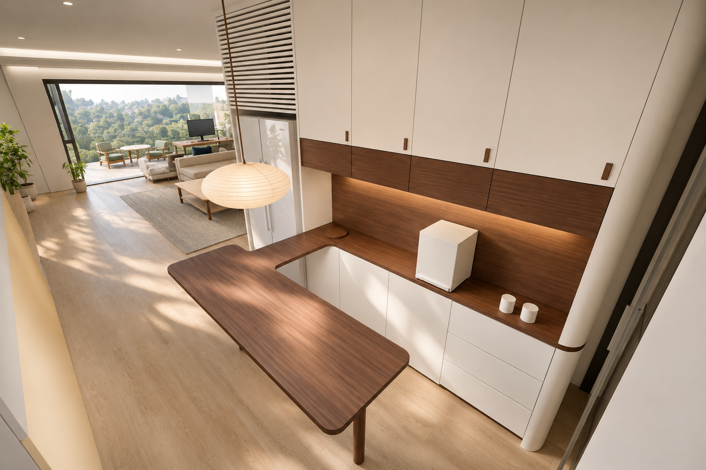
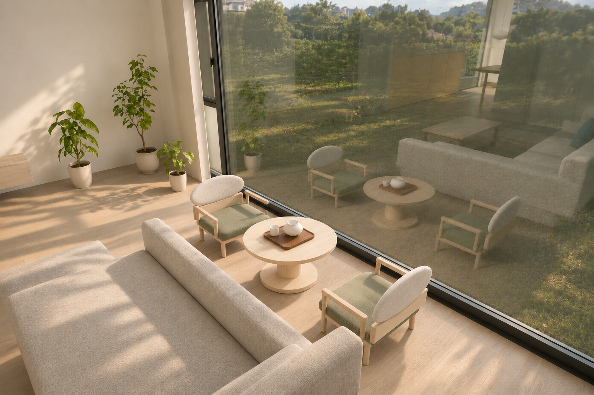
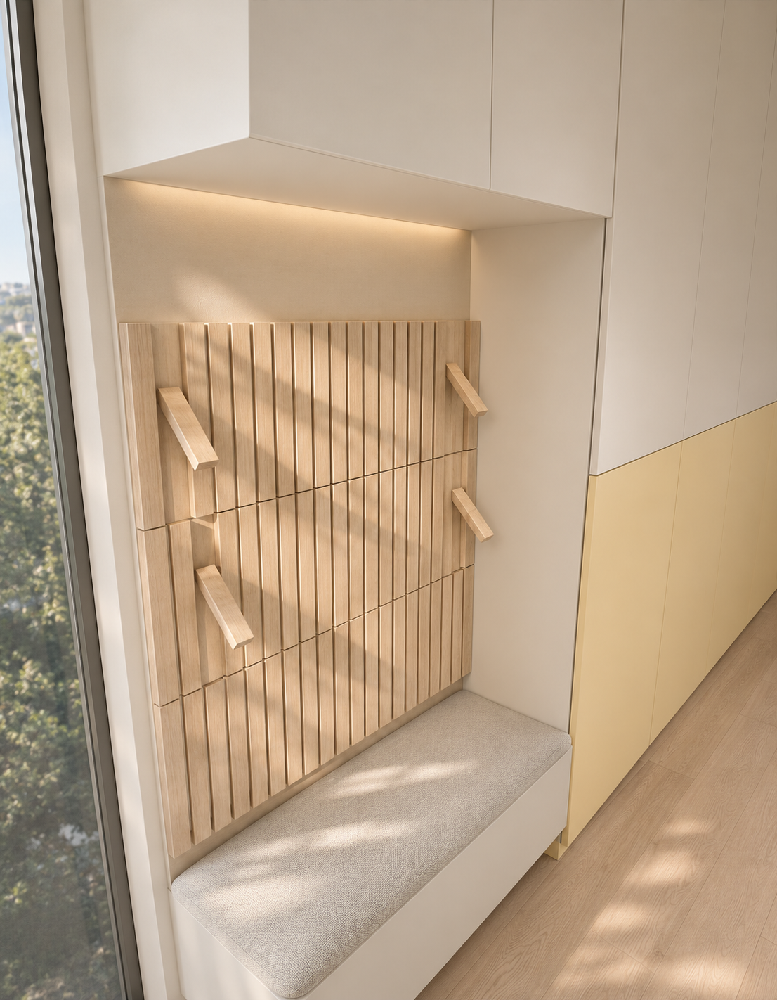

# 房屋设计项目 · HomeDesign

当前为 **v20 实装完整版**：餐边柜与胡桃木 U 形餐岛、沙发后办公区及近端半墙、入户左右分区、吊顶与风口协调、柜内收纳、圆弧及收口、地毯、洗烘柜，以及主卫扩建和走廊墙线对齐均已进入概念主模型。28组家具保留尺寸悬停与100 mm移动。风格为自然现代日式，暖白浅木为主，局部深木、绿、深蓝及奶黄；后续不考虑预算。

## 换电脑接续

先读 **[跨电脑交接文件（2026-11-18）](HomeDesign_CODEX_HANDOFF_20261118.md)**。新电脑先完整克隆仓库，再核验完整 v20、恢复技能与运行环境，最后进入本地和 GitHub 的同步更新。

```text
git clone --recurse-submodules --no-single-branch https://github.com/yangdyjp-glitch/housedesign.git
```

六个设计技能快照见 [迁移目录](tools/migration/)；只读核验使用 `python tools/migration/verify-handoff.py --root <项目目录> --baseline`。克隆不含 `tools/runtime/`、原电脑用户配置和凭据，新机需要重建运行环境。

旧根目录交接文件 `Home_Design_Codex_HANDOFF.md` 是初期安装方案；其“尚未设计”不代表当前状态。历史文档的旧“当前”记录以最新活动入口为准。

## 当前成果

- **四区效果与实装细节**：[完整 v20 图集](09_delivery/v20-complete/index.html) · [实装说明](09_delivery/v20-complete/实装说明.md) · [设计参数](09_delivery/v20-complete/设计参数.json)。
- **VR全景**：[打开四点360°漫游07](09_delivery/vr-tour-v07/打开360全景漫游.html)。请完整下载后在浏览器打开；GitHub文件页面会显示源文件。
- **可移动模型**：[完整 v20 查看器](09_delivery/house-v20-complete-preview.html)，28组家具可悬停查看长宽高、按100 mm移动并撤销。
- **主卧主卫平面图**：[前后对照](09_delivery/master-suite-plans-20261110/主卧主卫-修改前后对照.png) · [修改前](09_delivery/master-suite-plans-20261110/主卧主卫-修改前.png) · [修改后](09_delivery/master-suite-plans-20261110/主卧主卫-修改后-v20.png)。
- **当前依据**：[项目概要](01_brief/project-brief.md) · [用户决定](01_brief/decisions.md) · [假设与待核](01_brief/assumptions.md) · [项目状态](logs/project-status.md)。

| 客厅 | 餐厅 |
|---|---|
|  |  |
| 阳台 | 门厅 |
|  |  |

## 当前可编辑源文件

| 文件 | 用途 |
|---|---|
| [active-model.json](06_blender/active-model.json) | 当前模型、版本、路径与SHA256的入口 |
| [home-main-v20-complete.blend](06_blender/home-main-v20-complete.blend) | 完整实装主模型，含完整墙体、家具、柜体、门与顶面 |
| [geometry-master-v20-complete.json](02_geometry/geometry-master-v20-complete.json) | 当前毫米几何、家具整组、组成件与来源 |
| [modern-japanese-v20-complete.json](05_style/modern-japanese-v20-complete.json) | 同版风格和设计参数 |
| [blender-layout-v20-complete.json](03_layout/blender-layout-v20-complete.json) | 当前家具位置与核对 |
| [active-presentation.json](06_blender/active-presentation.json) | 当前效果、全景与渲染源入口 |
| [home-v20-complete-render-source.blend](06_blender/home-v20-complete-render-source.blend) | 同版原生渲染与全景参考源 |
| [最终交付核对.json](09_delivery/v20-complete/最终交付核对.json) | 完整实装、原生模型及交互核对记录 |

带 `-complete` 的文件是当前版本；较早 `home-main-v20.blend` 为餐区／办公整合版。旧模型、旧全景、研究及备份保留，不自动晋升为活动文件。部分历史构建脚本不可幂等执行，换电脑恢复时不要整套重跑。

## 重要设计状态

- 餐区继续不摆椅凳；白冰箱在客厅端、U岛外，胡桃木置物区与岛台齐平880高，右端白柜圆边，不用玻璃柜门。餐厨玻璃推拉门保留。
- 办公区从阳台端进入，近端实体半墙接右侧书柜，远端无新增家具栏杆；B深木为临时材质预览，A/C仍留档。
- 主卫新增段与原卫合并，洗手台—马桶—淋浴；走廊墙已收齐。斜向双折门是设计提案，未选定产品；2米床与左侧衣柜位置保留。
- 公共区家具位置沿用最新状态；不得重复叠加过去的移动。两台电脑轮流修改时先拉取，完成后提交推送并核对远端。

## 尺度与表现

项目记录单位mm；Blender为m，图面 `(x,z,height)` → `(x,-z,height)/1000`。方位上南下北、左东右西。100 mm是操作步长；手绘、结构、门窗、净高、排水、设备与节点仍需实测深化，概念模型不替代施工图。

当前摄影感VR为4个固定机位、单眼360×180，原生1774×887；同版原生几何球面4096×2048另存。AI微材质、反射、外景与光影是表现，不反写正式几何；不含自由行走／双眼立体。v20已做原生模型、离线交互逻辑和图片核对，本轮无真实浏览器WebGL或头显验收。更早的8K模型全景继续留档。

## 运行与目录

`00_source/`与`00_sources/`保留原图；`01_brief/`需求与决定；`02_geometry/`几何；`03_layout/`位置；`04_reviews/`审查；`05_style/`风格；`06_blender/`模型；`07_renders/`原生与摄影表现；`08_assets/`素材；`09_delivery/`交付；`logs/`核对与历史运行；`tools/`项目脚本。

原机使用Windows、Blender 4.5.15 LTS、Python 3.12.14和mcp-for-blender 2.2.6。依赖见 `tools/requirements-design.txt`、`tools/requirements-mcp.txt`。本机运行时、安装包、缓存与凭据不纳入仓库；`.gitattributes`保留原字节，避免跨电脑换行转换破坏SHA256。

仓库保留 `Staticfile`、`Caddyfile` 等原静态站点配置，交付入口为 `09_delivery/index.html`。本轮已验证GitHub文件同步；未检查远端托管服务的部署或公开网址状态。
