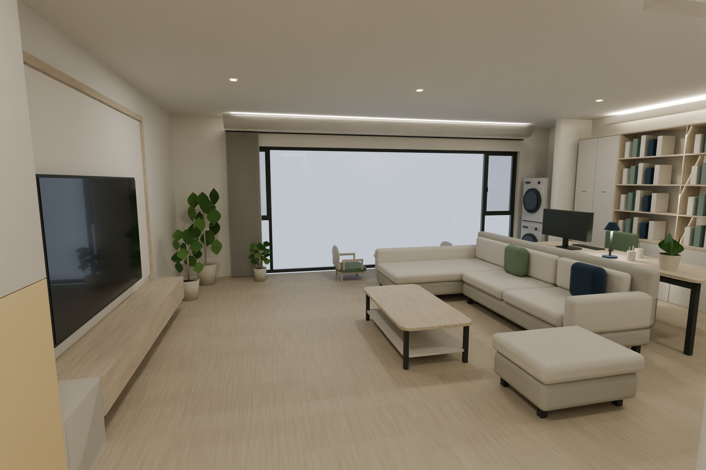
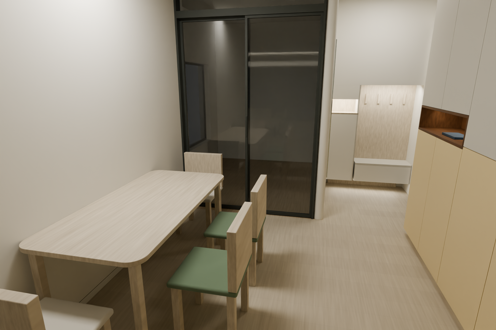
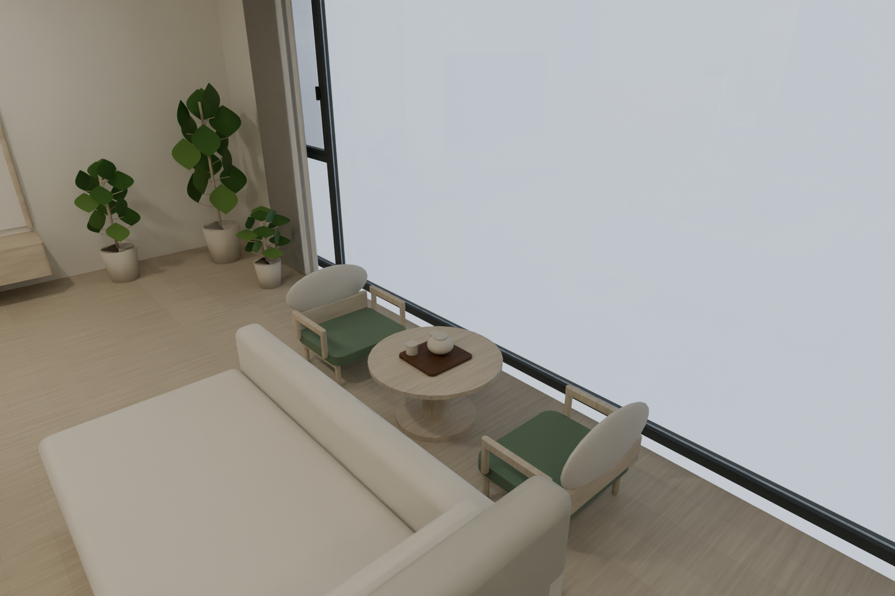
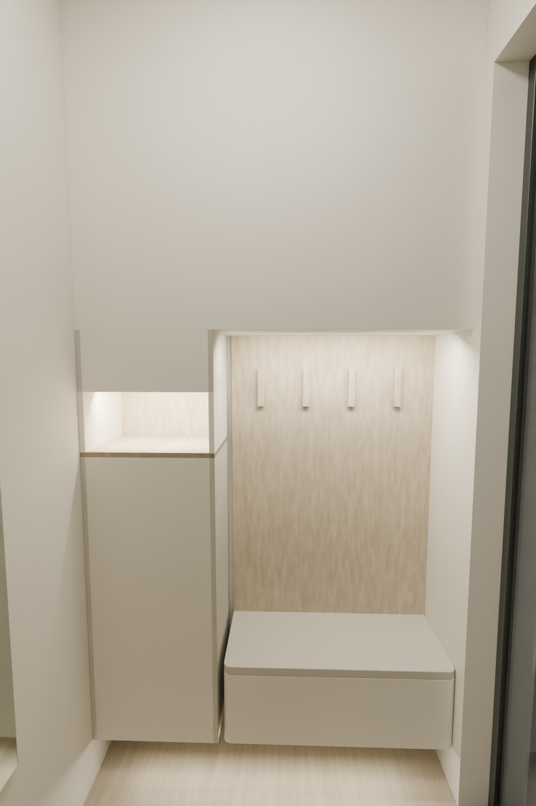

# 房屋设计项目 · HomeDesign

基于业主手绘尺寸、功能批注及持续交互调整的住宅装修设计档案。当前活动主模型为 **v14**，已按业主要求接入主卧主卫扩展概念；公共区23件既有家具保留，现代日式、暖白浅木、奶黄柜、绿与深蓝点缀。主卫尺寸、结构、原湿区范围、下层用途和排水仍未核，当前是设计方案，不作施工认证。

## 查看当前成果

- **主卧主卫调整**：[本轮说明与图集](09_delivery/v14-master-suite/调整说明.md) · [平面图](09_delivery/v14-master-suite/主卧主卫调整平面.png) · [主卫实体效果](07_renders/v14-master-suite/master-bath.png) · [剖切观察](07_renders/v14-master-suite/master-suite-cutaway.png)。扩展主卫内依次洗手台—马桶—淋浴，无浴缸，另加入2米床及左侧衣柜。
- **360°全景漫游（历史v13）**：[打开360全景漫游.html](09_delivery/vr-tour-v01/打开360全景漫游.html)。请下载仓库或克隆到本机后，用浏览器双击打开；GitHub文件页显示的是源文件。该漫游未重烘焙新主卫，当前改动以v14模型和图集为准。
- **完整离线交付包**：[四区360全景漫游ZIP](09_delivery/v13-餐厅门厅客厅阳台360全景漫游.zip)。含漫游、四张8K球面原图、可编辑模型、几何、风格与核验记录。
- **可移动家具模型**：[house-v14-preview.html](09_delivery/house-v14-preview.html)。本地浏览器打开，27件可悬停看长宽高、按100mm移动；主卫门和淋浴隔断可开合。洁具移动只是布局试排，未认定排水可迁移；修改位置后需重新渲染全景。
- **最新深化建议（尚未实施）**：[四区美观与实用性深化建议](04_reviews/四区美观与实用性深化建议-待选.md)。包括灯光、色彩、家具、收纳、门墙收口与两处椅后空间试排。
- [当前项目概要](01_brief/project-brief.md) · [用户决定](01_brief/decisions.md) · [假设与待核验](01_brief/assumptions.md) · [项目状态](logs/project-status.md)

| 客厅 | 餐厅 |
|---|---|
|  |  |
| 阳台 | 门厅 |
|  |  |

上述四幅图来自同一版v14实体模型原生Cycles渲染。历史v13完整球面影像为8192×4096、360×180单眼全景，可拖动、缩放和切换四个固定观察点；不是现场摄影，不含自由行走或双眼立体模式。电脑Chrome离线和浏览器触控模拟已核验，实体手机及头显未实测。

## 当前可编辑主文件

| 文件 | 用途 |
|---|---|
| [home-main-v14.blend](06_blender/home-main-v14.blend) | 完整墙体、27件家具/洁具代理、主卧主卫概念、材质、照明及门帘控制 |
| [active-model.json](06_blender/active-model.json) | 当前模型入口、版本、路径与SHA256 |
| [geometry-master-v14.json](02_geometry/geometry-master-v14.json) | 当前毫米几何、家具组成件、来源和兼容位置基线 |
| [modern-japanese-v10.json](05_style/modern-japanese-v10.json) | 当前风格与材质参数 |
| [blender-layout-v14.json](03_layout/blender-layout-v14.json) | 实际模型读回的当前家具位置 |
| [v14-delivery-verification.json](logs/v14-delivery-verification.json) | 本次交付与源文件核验 |

当前沙发、脚凳、茶几的平面x/z毫米坐标分别为3100/1300、3200/4350、2550/2650。原始版本、已选奶黄柜、短墙入户柜、矮茶席、85寸电视、单台34寸办公显示器、四椅靠墙餐桌等历史决定与来源均保留。

## 目录

| 目录 | 内容 |
|---|---|
| `00_source/`、`00_sources/` | 手绘图、功能批注、交接资料、PDF参考与已提取参考页 |
| `01_brief/` | 需求、用户决定、假设与当前设计原则 |
| `02_geometry/` | 各阶段几何、当前主几何与来源关系 |
| `03_layout/` | 布局、交互保存状态及迁移输入 |
| `04_reviews/` | 审美与实用性审查、未选深化建议 |
| `05_style/` | 风格版本、柜体候选与用户选择 |
| `06_blender/` | 当前及历史可编辑Blender模型 |
| `07_renders/` | 实体渲染、AI概念表现、8K全景原图、提示词与来源清单 |
| `09_delivery/` | 各阶段离线页面、示意图、说明与交付压缩包 |
| `logs/` | 实际运行、源哈希、保存重开、交互与浏览器核验 |
| `tools/` | 本项目建模、迁移、渲染、导出及核验脚本 |

## 单位、版本与使用边界

- 项目几何记录使用毫米；Blender使用米，图面`(x,z,height)`映射为`(x,-z,height)/1000`。方位按业主说明为上南下北、左东右西，并非测绘方位。
- 100mm是家具操作步长，不能代表现场尺寸精度。外轮廓、门窗、净高、结构、排水、设备与施工节点的未核项见假设记录。
- 当前模型与历史版本分开保存。修改前读取活动入口及最新布局，避免用旧交互快照覆盖新家具或重复叠加历史偏移。
- 实体模型、AI概念图和历史独立研究分别标明来源；v14主卫已接入概念模型，仍须核实扩卫允许性与机电条件。AI图像细节没有自动回写正式几何。
- 后续设计不考虑预算。收纳物品清单、材料实样、具体家具灯具和设备仍需深化。

## 本地运行环境

项目已在Windows、本机Blender 4.5.15 LTS及mcp-for-blender 2.2.6环境中使用。脚本中保留了原本机工作路径；迁移电脑时请先调整项目根目录和运行时路径，再按各脚本输入与版本约束运行。Python依赖清单见`tools/requirements-design.txt`和`tools/requirements-mcp.txt`。

`tools/runtime/`、下载的软件安装包、Python缓存、机器凭据不纳入版本仓库；设计原始资料、历史模型、图片、全景、交付包和审查记录保留。软件与依赖需在新电脑上另行安装，不能把环境安装视为所有历史脚本可无条件执行。

`.gitattributes`禁用换行转换，以保留几何、风格和来源文件的原始字节，确保记录的SHA256在不同平台克隆后仍可核验。
